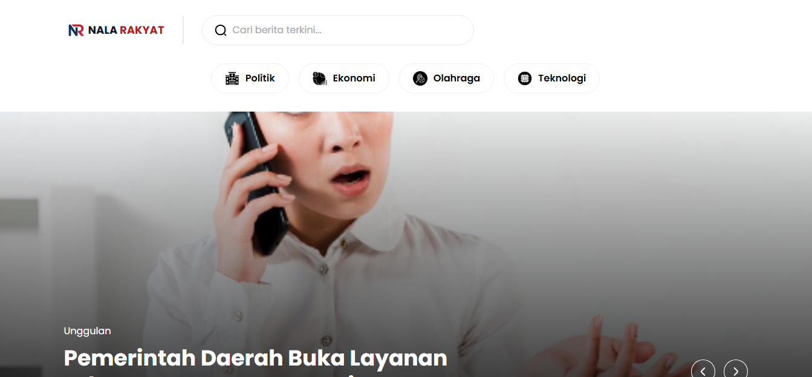
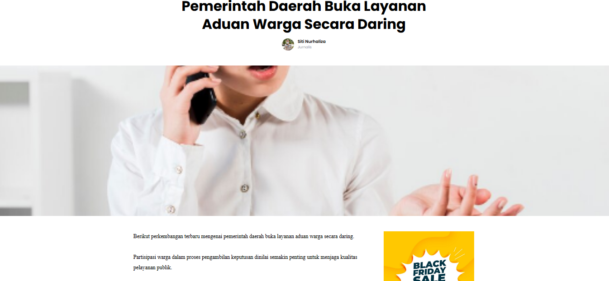
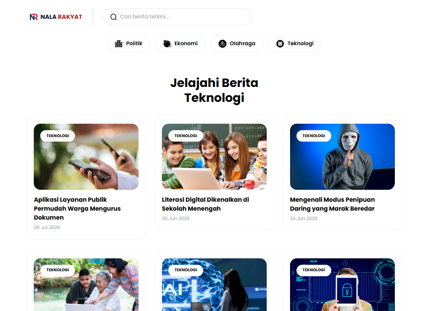
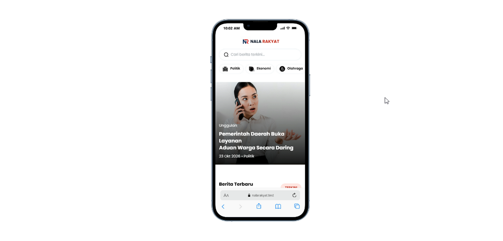
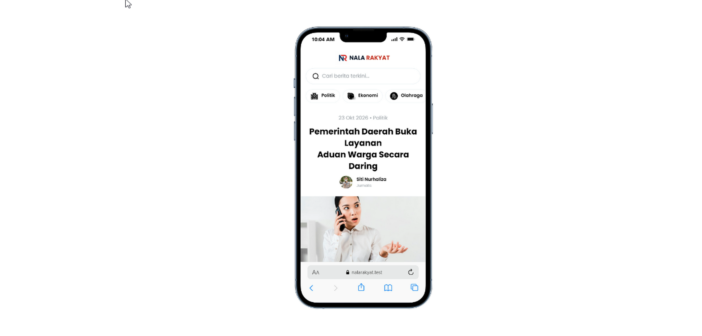
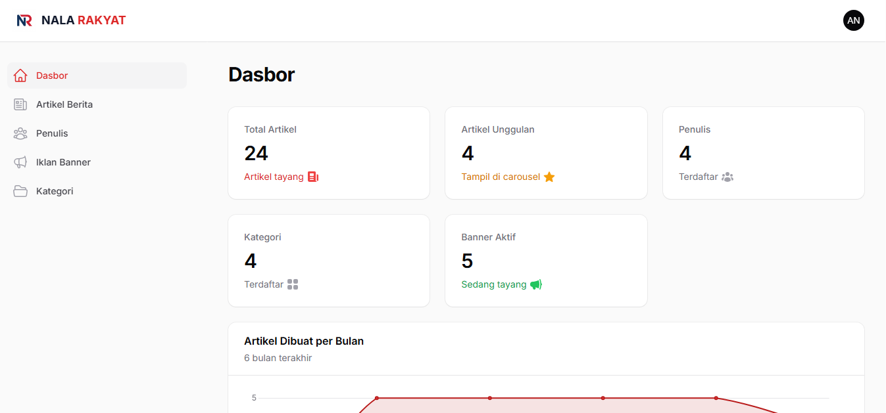
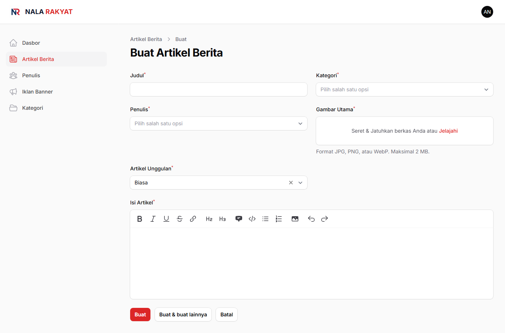
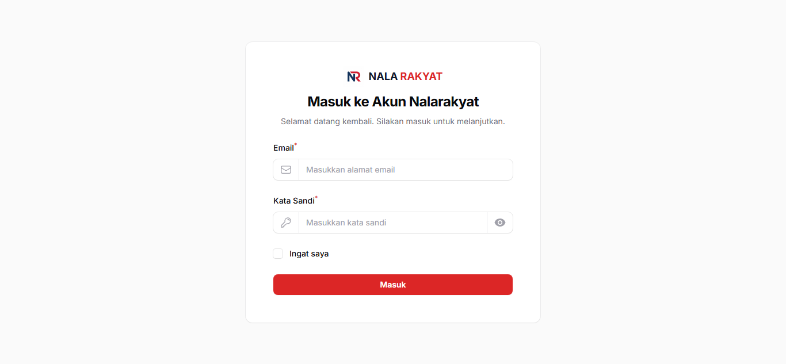

# Nalarakyat

Portal berita dengan panel admin untuk mengelola artikel, kategori, penulis, dan iklan banner. Frontend dibangun dari template HTML milik sendiri yang diubah menjadi view Blade dinamis, responsif di desktop, tablet, dan HP.



## Fitur

**Frontend (pembaca)**
- Beranda: carousel artikel unggulan, berita terbaru, daftar penulis, dan section per kategori
- Halaman detail artikel dengan sidebar, kotak penulis, tulisan lain dari penulis, dan artikel terkait
- Halaman kategori, penulis, dan pencarian dengan pagination
- Iklan banner di 4 posisi: header, sidebar, dalam artikel, dan footer
- Tampilan responsif (desktop, tablet, HP)
- SEO dasar: meta description, Open Graph, canonical, `sitemap.xml`, `robots.txt`
- Halaman 404 berbahasa Indonesia

**Panel admin (`/admin`)**
- Login kustom dengan tampilan bermerek Nalarakyat
- CRUD artikel, kategori, penulis, dan iklan banner
- Soft delete dengan pemulihan dan hapus permanen
- Rich text editor dengan upload gambar di dalam isi artikel
- Slug otomatis dan unik
- Dasbor: kartu statistik, grafik artikel per bulan, dan tabel artikel terbaru
- Admin menginput semua konten. Penulis tidak memiliki akun login.

## Teknologi

| Bagian | Teknologi |
|---|---|
| Backend | Laravel 11.57, PHP 8.2 |
| Panel admin | Filament 3.3 |
| Database | MySQL |
| Frontend | Blade, Tailwind CSS (hasil kompilasi template), Flickity |
| Lingkungan lokal | Laravel Herd (Windows) |

## Tampilan

| Beranda | Detail artikel |
|---|---|
|  |  |

| Kategori | Mobile |
|---|---|
|  |   |

| Dasbor admin | Form artikel |
|---|---|
|  |  |



## Instalasi

Prasyarat: PHP 8.2+ (ekstensi `intl`, `gd`, `mbstring`, `pdo_mysql`), Composer, dan MySQL.

```bash
git clone https://github.com/muhamadandy/nalarakyat.git
cd nalarakyat

composer install
cp .env.example .env
php artisan key:generate
```

Atur koneksi database di `.env`:

```dotenv
APP_URL=http://nalarakyat.test
APP_LOCALE=id
APP_TIMEZONE=Asia/Jakarta

DB_CONNECTION=mysql
DB_DATABASE=nalarakyat
DB_USERNAME=root
DB_PASSWORD=
```

Buat database kosong bernama `nalarakyat`, lalu jalankan:

```bash
php artisan migrate --seed
php artisan storage:link
php artisan serve
```

Dengan Laravel Herd, letakkan proyek di folder Herd dan buka `http://nalarakyat.test`. Tanpa Herd, buka `http://127.0.0.1:8000` dan sesuaikan `APP_URL`.

## Akun demo

| Halaman | URL | Email | Password |
|---|---|---|---|
| Panel admin | `/admin` | `admin@nalarakyat.test` | `password` |

Akun ini hanya untuk lingkungan lokal. Di produksi, isi `ADMIN_EMAIL` dan `ADMIN_PASSWORD` di `.env` dengan nilai yang kuat sebelum menjalankan seeder.

## Data contoh

`php artisan migrate --seed` membuat:

- 1 akun admin (selalu dibuat)
- 4 kategori, 4 penulis, 24 artikel, dan 5 banner aktif (hanya di lingkungan non-produksi)

Gambar contoh dibuat otomatis dengan ekstensi GD dan disimpan di `storage/app/public/seed`, jadi tidak ada gambar berhak cipta di repository. Seeder data contoh tidak berjalan saat `APP_ENV=production`.

## Struktur penting

```
app/
├── Filament/
│   ├── Pages/Auth/Login.php        # Login kustom
│   ├── Resources/                  # Artikel, kategori, penulis, banner
│   └── Widgets/                    # Statistik, grafik, artikel terbaru
├── Http/Controllers/FrontController.php
└── Models/
database/seeders/                   # AdminSeeder, SampleDataSeeder
resources/views/front/              # Layout, halaman, dan partial frontend
public/front/                       # Aset template (CSS, JS, gambar)
```

## Catatan teknis

- **Penulis dipisah dari `users`.** Tabel `users` hanya untuk admin yang login, sedangkan `authors` hanyalah profil yang ditampilkan di artikel.
- **Soft delete pada semua model utama.** Relasi artikel ke kategori dan penulis memakai `withTrashed()` agar artikel lama tidak error saat kategori atau penulisnya dihapus.
- **Slug unik.** Slug dibuat saat data dibuat dan tidak berubah saat judul diedit, supaya tautan yang sudah dibagikan tidak rusak. Jika ada duplikat, ditambahkan akhiran angka.
- **URL gambar relatif.** Disk `public` memakai `'url' => '/storage'` agar gambar di dalam isi artikel tidak menyimpan nama domain dan tetap aman saat pindah server.
- **Responsif lewat override CSS.** `output.css` dari template adalah hasil kompilasi dan tidak memuat class Tailwind baru, jadi penyesuaian layar kecil ditulis sebagai media query di `public/front/css/nalarakyat.css` tanpa mengubah tampilan desktop.
- **Penyisipan iklan dalam artikel.** Banner posisi "Dalam Artikel" disisipkan setelah paragraf ke-2 pada isi artikel, dan tidak ditampilkan jika artikel terlalu pendek.

## Rencana pengembangan

- Tanggal mulai dan berakhir tayang pada iklan banner
- Peran admin (editor dan pengelola iklan)
- Pembersihan otomatis file gambar yatim saat artikel dihapus permanen
- Halaman "Pasang Iklan" untuk calon pengiklan

## Lisensi

Kode aplikasi ini dibuat oleh Muhamad Andy sebagai proyek magang. Tentukan lisensi sebelum dipakai ulang oleh pihak lain.
